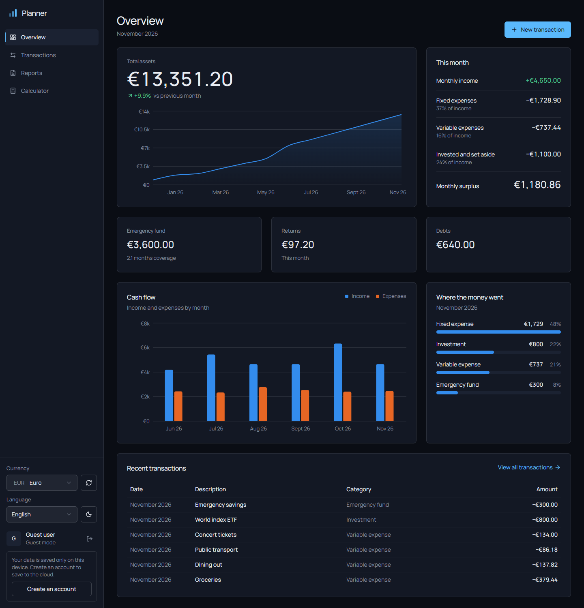
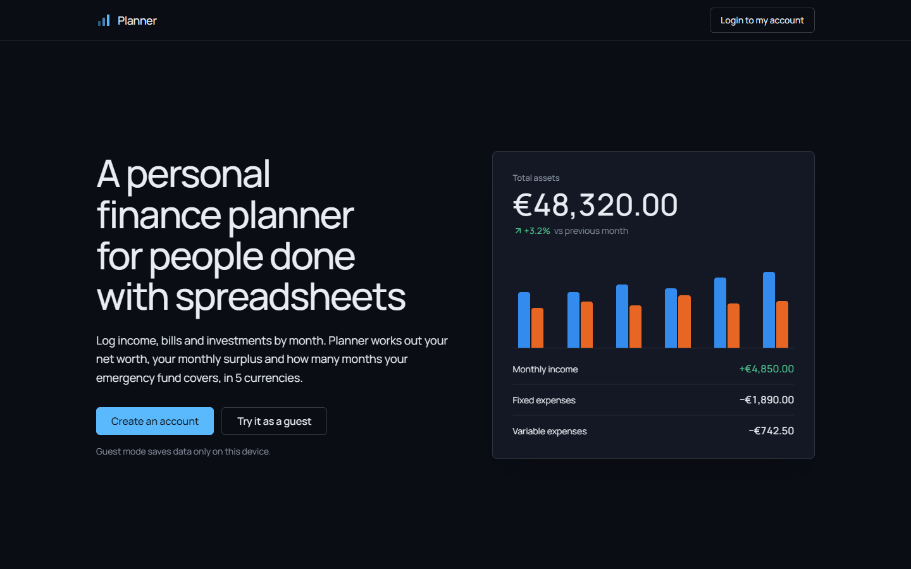
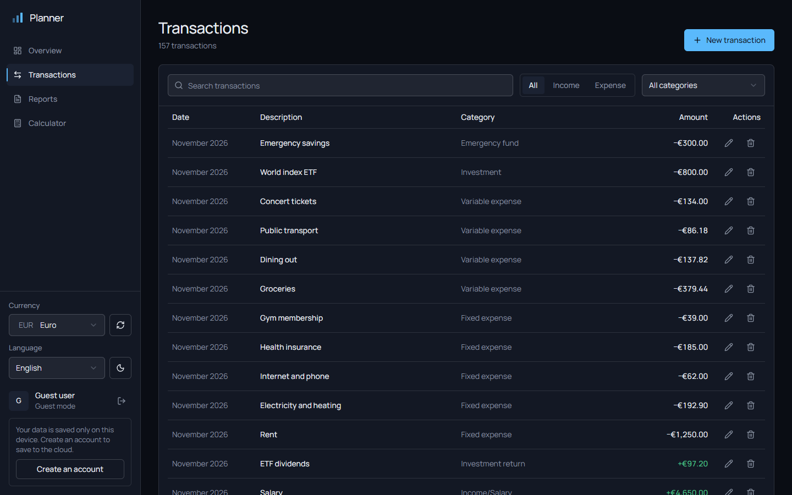
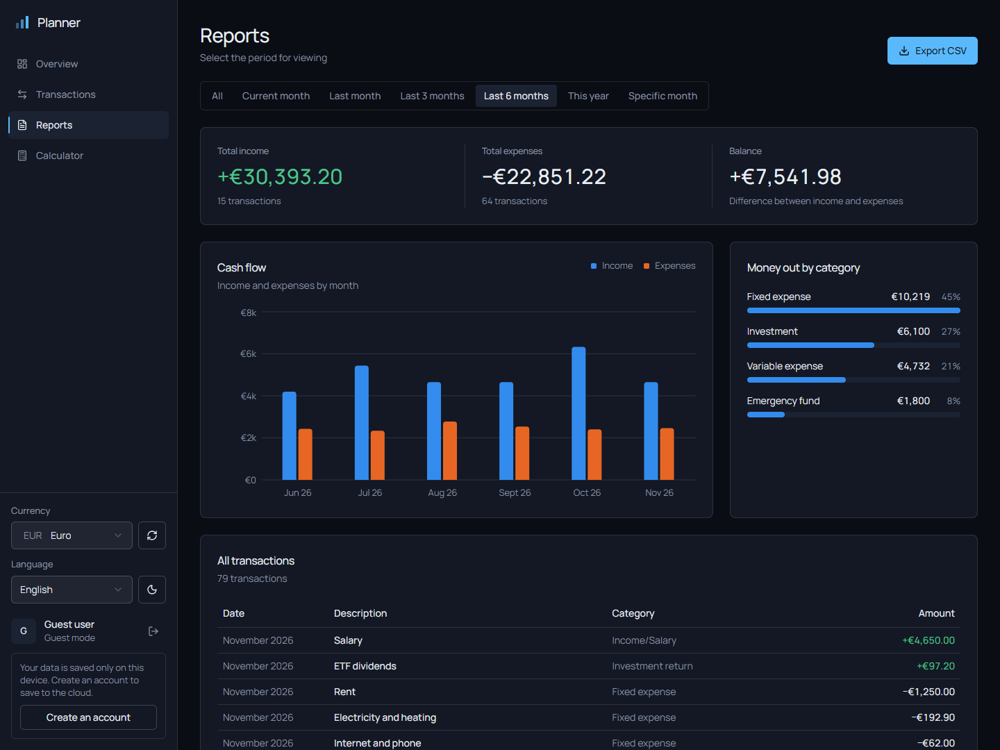
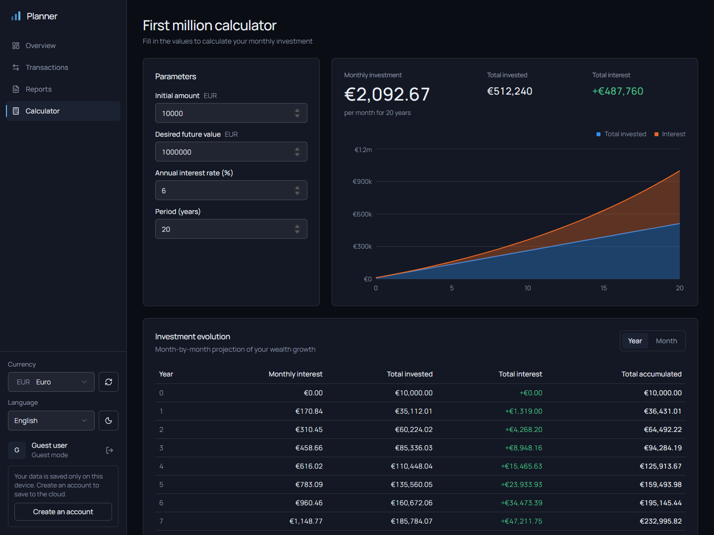
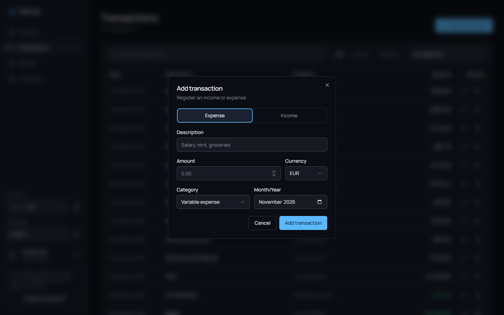
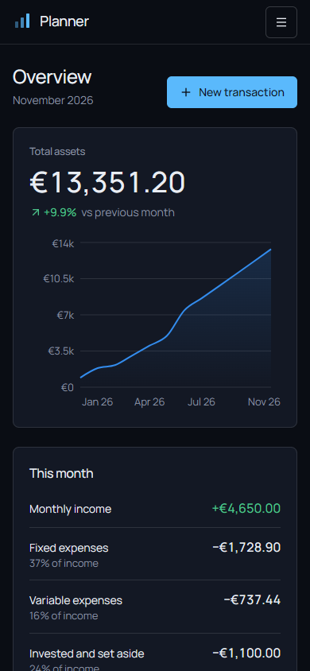

  <h1>💰 Financial Planner - Personal Finance Dashboard</h1>
  <blockquote>
    
<em>Because spreadsheets are so 2010, and we all know tracking expenses on paper napkins doesn't scale.</em>

  </blockquote>

 

Planner is a full-featured personal finance management application that helps you keep your financial life organized without needing a finance degree. Built with modern web technologies, it provides real-time insights into your income, expenses, investments, and overall financial health through an intuitive dashboard interface.

<strong>Think of it as your financial command center - minus the stress of staring at endless Excel rows.</strong>

 

<h2>🤔 Why Does This Exist?</h2>

Let's be honest: most finance apps either look like they were designed in 1999 or they're so overloaded with features that you need a manual just to log a coffee purchase. We built Planner because:

<ul>
  <li><strong>Personal finance shouldn't be intimidating</strong> - Clean UI, straightforward metrics, no BS</li>
  <li><strong>You deserve to see your money in real-time</strong> - Dynamic charts that actually update when your financial situation changes</li>
  <li><strong>Privacy matters</strong> - Your financial data stays with you, not scattered across third-party servers (looking at you, random fintech startups)</li>
  <li><strong>Customization is key</strong> - Multi-currency support, flexible expense tracking, and adaptable to different financial goals</li>
</ul>

The project started as a way to solve our own problem: wanting a finance tracker that didn't make us feel like we needed an accounting certification to use it.

 

<h2>📸 Screenshots</h2>

All screenshots use made-up demo data.

<table>
  <tr>
    <td width="50%"></td>
    <td width="50%"></td>
  </tr>
  <tr>
    <td align="center"><strong>Welcome</strong> - sign in, sign up or try it as a guest</td>
    <td align="center"><strong>Transactions</strong> - search, filter, edit and delete</td>
  </tr>
  <tr>
    <td></td>
    <td></td>
  </tr>
  <tr>
    <td align="center"><strong>Reports</strong> - pick a period, export it as CSV</td>
    <td align="center"><strong>Calculator</strong> - what to invest each month to hit a target</td>
  </tr>
  <tr>
    <td colspan="2" align="center"></td>
  </tr>
  <tr>
    <td colspan="2" align="center"><strong>New transaction</strong> - one form, any of five currencies</td>
  </tr>
</table>

 

<h2>✨ Core Features</h2>

<h3>📊 Dashboard Analytics</h3>
<ul>
  <li><strong>Total Assets Overview</strong> - See your net worth at a glance with month-over-month growth tracking</li>
  <li><strong>Monthly Surplus Calculation</strong> - Automatic calculation of what you're actually saving (or not)</li>
  <li><strong>Emergency Fund Tracker</strong> - Know exactly how many months of coverage you have</li>
  <li><strong>Debt Management</strong> - Keep tabs on what you owe without the anxiety spiral</li>
</ul>

<h3>💸 Income & Expense Tracking</h3>
<ul>
  <li><strong>Fixed vs Variable Expenses</strong> - Separate recurring bills from your spontaneous purchases</li>
  <li><strong>Monthly Income Monitoring</strong> - Track salary, side hustles, or whatever keeps the lights on</li>
  <li><strong>Search, Filters and CSV Export</strong> - Find any transaction, slice reports by period and take the data with you</li>
  <li><strong>Historical Trends</strong> - 6-month visualizations to spot patterns (like that suspicious spike every time a new game drops)</li>
</ul>

<h3>📈 Investment Performance</h3>
<ul>
  <li><strong>Returns Tracking</strong> - Monitor how your investments are performing</li>
  <li><strong>Comparative Analysis</strong> - Visual comparison between investment growth and actual returns</li>
  <li><strong>Performance Metrics</strong> - See if your portfolio is actually making you money or just keeping you entertained</li>
</ul>

<h3>🎨 User Experience</h3>
<ul>
  <li><strong>Dark and Light Themes</strong> - Dark by default, because who wants a blinding white screen when checking finances at 2 AM</li>
  <li><strong>Multi-Currency Support</strong> - Log in BRL, USD, EUR, GBP or HUF and view everything converted to the currency you pick</li>
  <li><strong>Five Languages</strong> - Portuguese, English, Hungarian, Italian and German, switched without a reload</li>
  <li><strong>Guest Mode</strong> - Try it without an account; data stays in your browser until you sign up, then syncs</li>
  <li><strong>Responsive Design</strong> - Works on desktop, tablet, and mobile</li>
</ul>

 

<h2>🛠️ Tech Stack</h2>

<strong>Frontend Framework:</strong>

  

<ul>
  <li><strong>Charts & Visualization:</strong> Recharts, with a colour-blind-safe two-colour palette</li>
  <li><strong>Styling:</strong> Tailwind CSS 4 with design tokens for dark and light themes, Radix UI primitives</li>
  <li><strong>Auth & Data:</strong> Auth0, Prisma and MongoDB (guest mode uses localStorage)</li>
  <li><strong>State Management:</strong> Zustand</li>
  <li><strong>Currency Handling:</strong> Multi-currency architecture with locale support</li>
</ul>

 

<h2>🚀 Getting Started</h2>

<pre><code>npm install
npm run dev</code></pre>

Open <code>http://localhost:3000</code> and choose <strong>Try it as a guest</strong>: guest mode needs no setup. For accounts and cloud sync, add a <code>.env.local</code> with:

<ul>
  <li><code>DATABASE_URL</code> - MongoDB connection string</li>
  <li><code>AUTH0_SECRET</code>, <code>AUTH0_BASE_URL</code>, <code>AUTH0_ISSUER_BASE_URL</code>, <code>AUTH0_CLIENT_ID</code>, <code>AUTH0_CLIENT_SECRET</code> - Auth0 application settings</li>
  <li><code>NEXT_PUBLIC_OPEN_EXCHANGE_RATES_APP_ID</code> - optional, for live exchange rates (built-in approximate rates are used without it)</li>
</ul>

 

<h2>🗺️ Roadmap</h2>

<ul>
  <li>⬜ Budget planning with alerts</li>
  <li>⬜ Recurring transaction automation</li>
  <li>✅ CSV export</li>
  <li>⬜ PDF reports</li>
  <li>⬜ Goal setting and tracking</li>
  <li>⬜ Multi-account management</li>
  <li>⬜ Mobile app version</li>
</ul>

 

<h2>🤝 Contributing</h2>

Found a bug? Have an idea for a killer feature? PRs are welcome! Please check the issues page first to see if someone else has already thought of it.

 

<h2>⚠️ Disclaimer</h2>

This app helps you track your finances, but it won't magically make you rich. That part's still on you. 😄

 

  
<strong>Made with ☕ and a healthy dose of financial anxiety</strong>

